DevonCraft Survival Edition
===========================

DevonCraft is a survival-focused continuation of the original [Crafti](https://github.com/Vogtinator/crafti) game by Fabian Vogt: 3D Minecraft-inspired play for TI-Nspire calculators running Ndless.
This source tree includes a dedicated compatibility path for the original monochrome TI-Nspire CAS ClickPad (OS 3.9.0.463, Boot2 3.0.1.131), alongside the color CX path. The ClickPad code has been audited at source level but still requires a real-device build and test; see [the ClickPad port notes](docs/clickpad-port.md).
The goal is 1.8.8-style survival play (items, mining, mobs, and difficulty levels) on a calculator.

> **Status:** survival basics are playable: hold-to-mine with tool tiers, block drops, a day/night cycle,
> crafting, furnaces, chests, beds, the smithing table, lakes to swim in and scoop with a bucket, and seven biomes.
> Passive pig and cow mobs now spawn on grass in daylight, wander, and drop raw meat when hunted.
> Screenshots are reference captures from this source snapshot; the menu and help screens have been refreshed for DevonCraft branding.

Screenshots
-----------

| | |
|---|---|
| 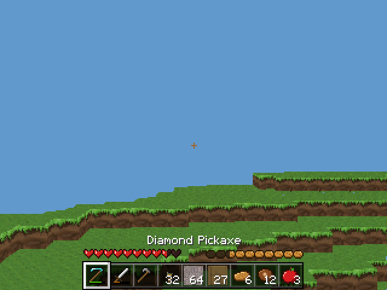 | 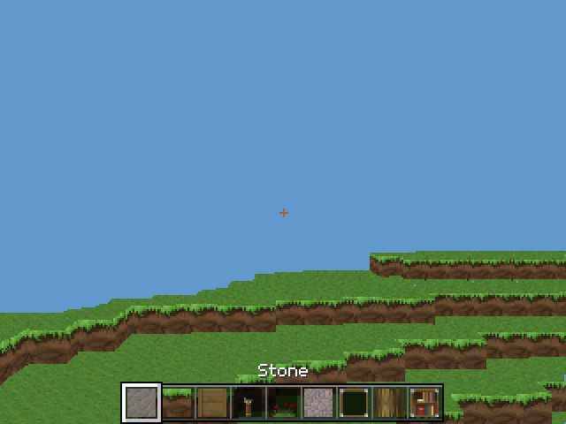 |
| Survival: hearts, hunger and the 9-slot hotbar | Creative: the same hotbar, without hearts and hunger |
| 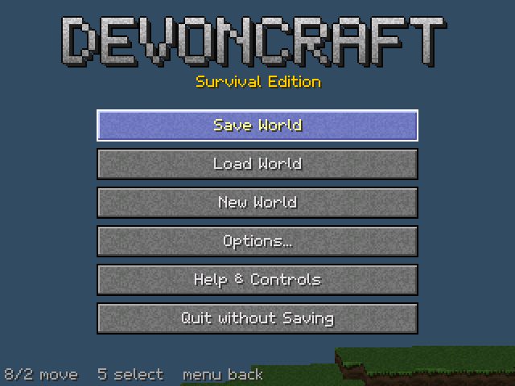 | 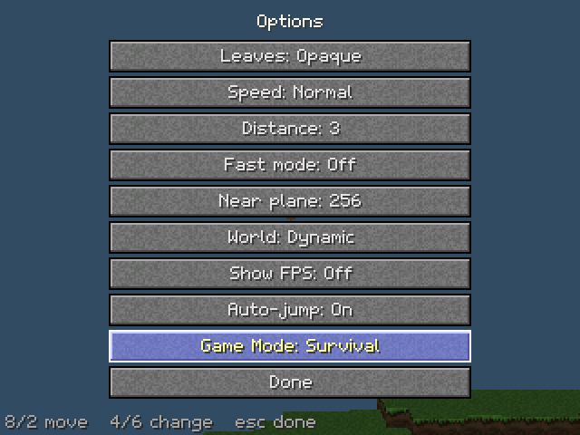 |
| Game menu | Options, with Auto-jump and Game Mode |
| 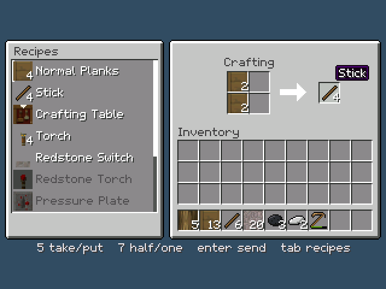 | 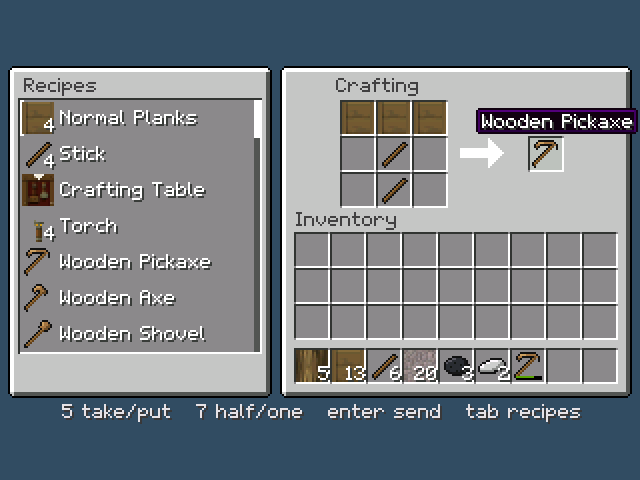 |
| Survival inventory with its 2x2 crafting grid | Crafting table: a 3x3 grid beside the recipe list |
| 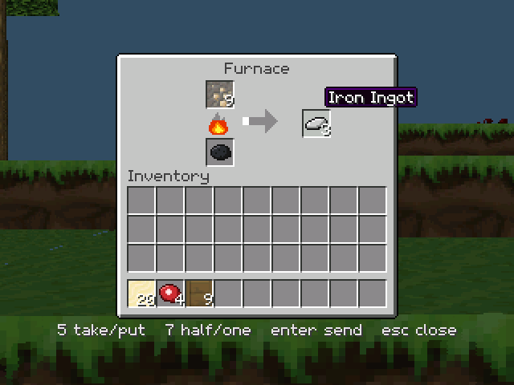 | 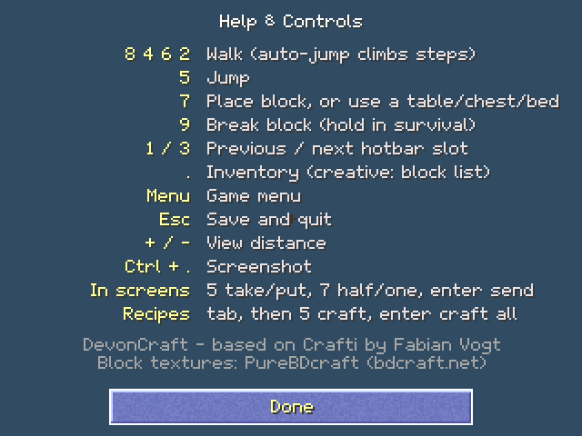 |
| Furnace: input, fuel and output, with the flame and progress arrow | Help & Controls |
| 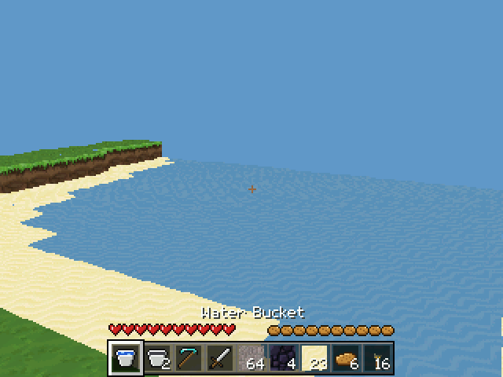 | 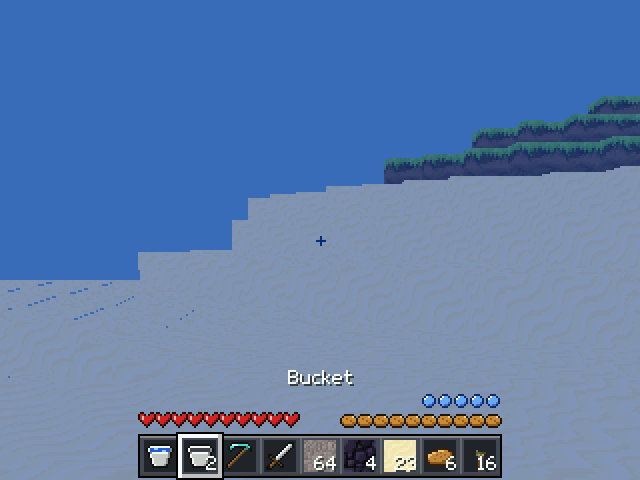 |
| Lakes with sand beaches; buckets carry water | Underwater: the view turns blue and your air runs down |
| 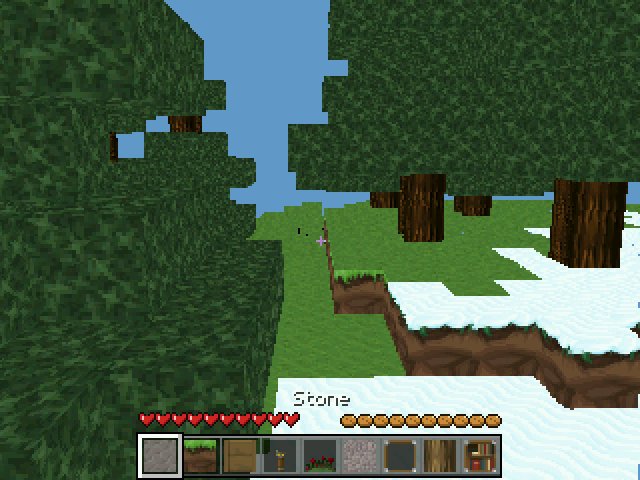 | 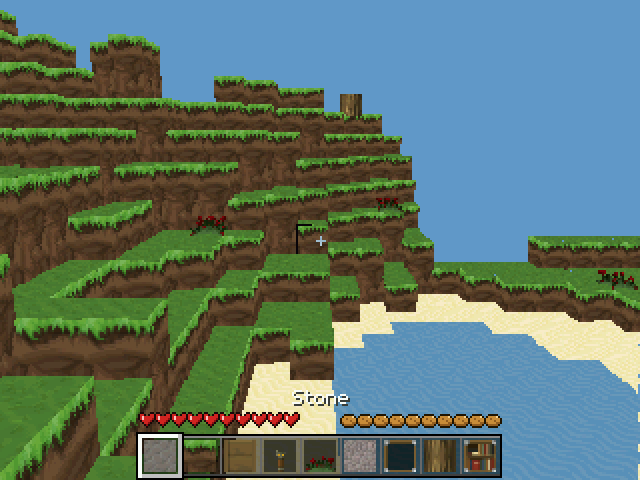 |
| Ice Plains meets Taiga: snow, frozen lakes and spruce | Extreme Hills rising out of the Plains |
| 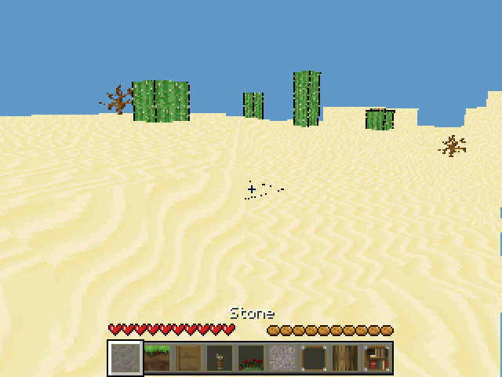 | 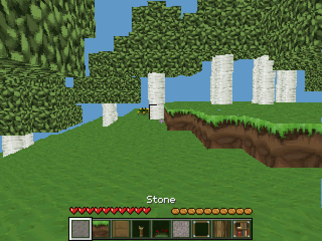 |
| Desert: sand over sandstone, cacti and dead bushes | Birch Forest |
| 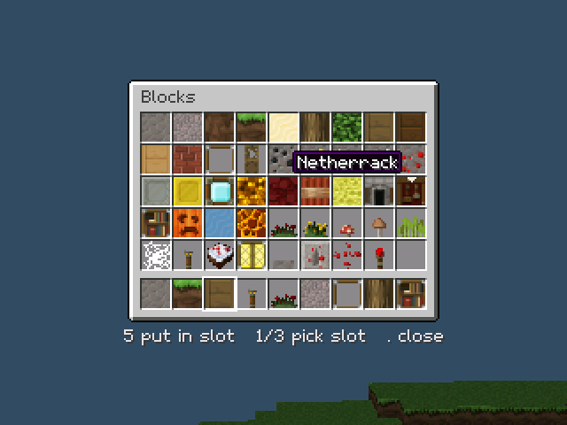 | |
| Creative block list | |

All UI art is original: the pixel font, hearts, hunger, item icons and the title wordmark are drawn by scripts in `tools/` (previews in `tools/preview/`). Nothing is copied from Minecraft or Eaglercraft.

What's new so far
-----------------

- **Eaglercraft-style UI:**
  - a 9-slot hotbar with item counts and wear bars
  - hearts, hunger and air bubbles
  - an inventory screen
  - button menus and a pixel font with drop shadows
- **Items:** 56 items, each with its own icon: tools in six materials, food, ores, materials, buckets and snowballs.
- **Game mode:** switch between Survival and Creative in Options (locked in Hardcore).
- **Low graphics:** caps the active chunk radius at 3 on CX (2 on the original monochrome CAS), matching Abyssal Transcendence's Low preset, uses opaque leaves, and skips cosmetic block animations and particles while preserving original block textures. The renderer keeps its pre-rendered textured-quad path in both Normal and Low. It leaves generated terrain and saved block data unchanged. The **Graphics** option applies Normal or Low in one step; Low selects this mode and its 3-chunk CX distance cap (2 on original monochrome CAS). The Low graphics and Distance rows remain editable afterward.
- **Terrain compatibility mode:** new chunks use the earlier seeded Perlin generator and its seven legacy biome families, restoring the rolling terrain profile from the known terrain-loading build. Chunk clearing remains row-safe, and the newer surface-decoration/tree-placement fixes are retained. The existing water texture, sea fill, and water-rendering path are unchanged. Existing saved chunks are not rewritten.
- **Passive mobs:** Pigs and cows spawn on grass in daylight, wander slowly, despawn when far from the player, and drop raw pork or beef after five bare-hand hits. Mobs use original low-poly 3D cuboid models and a dedicated 16x16-tile pixel-art texture atlas; mob entities are transient and are not saved.
- **Game clock:** fixed 20 ticks per second, independent of frame rate.
- **Entities:** up to 32 entities with physics and collision.
- **Achievements and advancements:** persistent unlocks for inventory, gathering wood, crafting, mining stone, tools, furnaces, iron, diamonds, beds and building. Open either screen from the game menu. Advancement criteria can be met early and complete automatically once their parent advancement is unlocked.
- **Custom boot screen:** an original DevonCraft pixel-art startup UI with the wordmark, monochrome-safe palette, and staged loading indicator before the world selector.
- **World loader:** eight separate world slots. The first slot keeps the existing DevonCraft/Crafti save path; seven additional slots use independent save files. Startup opens the world selector, and the menu can load or create worlds in empty slots. Switching worlds saves the current world first. Unreadable saves are left untouched.
- **Saves:** new save format (v8) with an automatic backup. Existing v7 worlds and older v6 worlds still load; existing worlds start with empty progression.
- **Lighting:** 8 brightness levels for the coming day/night cycle.
- **Auto-jump:** walks you up one-block steps.
- **Mining:** hold 9 to break blocks at 1.8.8 speeds. Tools have tiers and wear out, and blocks drop items you walk over to collect.
- **World:** a sun and moon with a day/night cycle, more common emeralds, Ancient Debris near bedrock, and saplings that grow into trees.
- **Crafting:** Minecraft's shaped recipes in a 2x2 grid in your inventory and a 3x3 grid at a crafting table (press 7 on one), plus a recipe list beside the grid. Pick a recipe to see its shape in the empty grid, then press 5 to craft it straight from your inventory or 7 to lay it out in the grid. The table makes tools, furnaces, chests, beds, storage blocks and more.
- **Furnaces:** input, fuel and output slots; each item takes 10 seconds. Coal or charcoal smelts 8 items, a log or plank 1.5. Smelts ores to ingots, sand to glass, cobblestone to stone, raw meat, logs to charcoal and Ancient Debris to netherite scrap. Furnaces keep cooking while their chunk is loaded, and while you watch.
- **Chests, beds and the smithing table:** chests hold 27 stacks, beds skip the night and set your spawn, and the smithing table turns diamond tools into netherite.
- **Water:** new chunks have lakes, filled up to sea level, with sand beaches and seabeds. Water follows 1.8.8's rules:
  - **Swimming:** you sink slowly, hold 5 to swim up, and walk at half speed. Push against a low bank to climb out.
  - **Air:** with your head underwater you have 15 seconds of air (the bubbles above your hunger), and the view turns blue.
    Drowning damage comes with health.
  - **Buckets:** three iron ingots in a V at a crafting table. Press 7 with an empty bucket on still water to scoop it,
    and with a water bucket to pour it.
  - **Flowing:** flowing water between two still blocks becomes still (an infinite source). Lava touching water
    turns to obsidian (still lava) or cobblestone (flowing), and lava falling onto water turns it to stone.
  - You aim through water and lava, so you can mine the seabed and build into a lake. Blocks push fluids out.
- **Biomes:** new chunks belong to one of seven 1.8.8 biomes, each a few hundred blocks across:
  - **Plains:** open grass with flowers and the odd oak. **Forest:** oak with some birch. **Birch Forest.**
  - **Taiga:** spruce trees. **Ice Plains:** snow-covered grass, frozen lakes and a few spruce.
  - **Desert:** sand over sandstone, with cacti and dead bushes and no trees.
  - **Extreme Hills:** up to 15 blocks higher, with bare rock on the cliffs and snow on the peaks.
  - New blocks: sandstone, snow, ice, cactus, and spruce and birch wood, leaves and saplings. Spruce and birch wood make
    the dark and light planks, four sand make sandstone, and a shovel digs four snowballs out of snow, which pack back into
    a block. Ice melts into water when broken, and cacti only stand on sand with nothing beside them.
  - Turn on Show FPS in Options to see the biome you're in.
  - Biomes only shape chunks generated from now on, so the hills can end in a cliff where they meet land you've explored.
- **Stress test:** `devoncraft-stress.tns` shows FPS and ticks per second on the calculator.

Planned
-------

- Health, hunger and damage, including drowning
- Zombies, creepers, skeletons and a wandering trader
- Difficulties: Peaceful, Easy, Normal, Hard and Torment, plus a Hardcore switch

Building
--------

See [docs/building.md](docs/building.md) and [PUBLISHING.md](PUBLISHING.md). GitHub Actions builds `devoncraft.tns` and `devoncraft-stress.tns` on every push (see the **Actions** tab).

Controls
--------

| Key | In the world | In screens |
|---|---|---|
| 8 4 6 2 | Walk (auto-jump climbs steps) | Move the cursor / pick a recipe |
| 5 | Jump (hold in water to swim up) | Take or put down a stack; on the result slot, craft one / in the recipe list, craft one (hold to repeat) |
| 7 | Place block, use a bucket, or use a chest, furnace, crafting table, bed or smithing table | Take half, or put down one / in the recipe list, lay the recipe out in the grid |
| 9 | Break block (hold in survival) | |
| 1 / 3 | Previous / next hotbar slot | Pick the hotbar slot (block list) |
| . | Inventory (creative: block list) | Close |
| enter | | Send a stack to the other section / on the result slot or in the recipe list, craft as many as you can |
| tab | | Switch between the slots and the recipe list |
| menu | Game menu | Back |
| 8 / 2 | | Move through achievements, advancements or the world list |
| esc | Save and quit | Close |
| + / - | View distance | |
| ctrl + . | Screenshot | |
| ctrl + shift + . | Save screenshot and toggle USB transfer mode while the game stays open | |

During USB transfer mode, DevonCraft keeps running with the operating system's USB file-transfer interrupts enabled. Use the DevonCraft USB Bridge (or a compatible TI-Nspire file manager) to receive the newest `/documents/ndless/screenshot_N.ppm.tns` file; do not use live-screen capture. Press **ctrl + shift + .** again to restore the game's normal interrupt-masked mode. The original **ctrl + .** screenshot shortcut remains unchanged.

Limitations
-----------

DevonCraft uses fixed-point rendering, so some graphical inaccuracies remain.

Credits
-------

DevonCraft is based on the original Crafti project by [Fabian Vogt (Vogtinator)](https://github.com/Vogtinator/crafti), winner of the ticalc.org Program of the Year 2014. Original author and third-party asset credits are preserved in `license.txt`.
Block textures from PureBDcraft by https://bdcraft.net.
